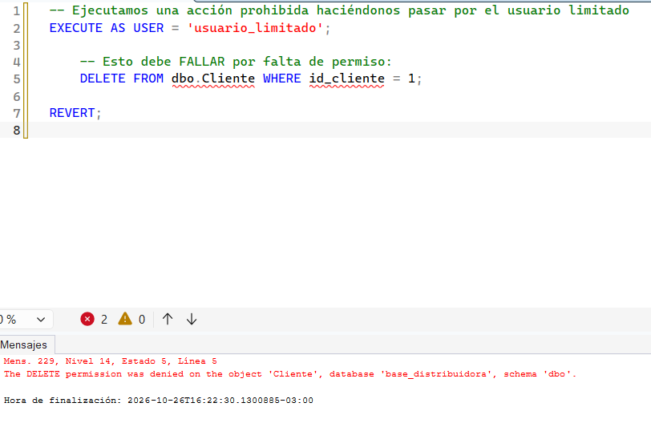
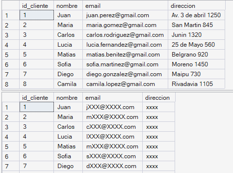
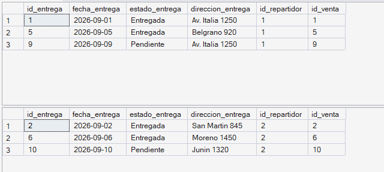
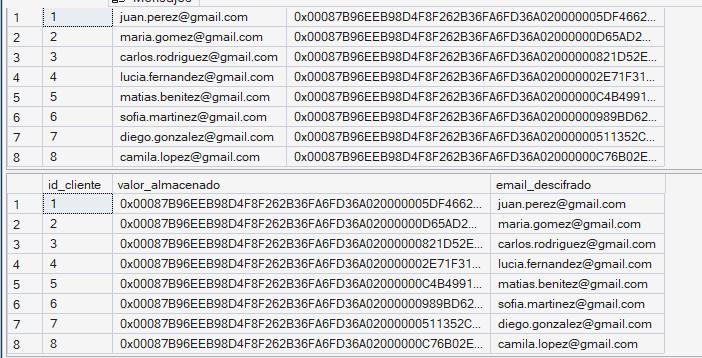
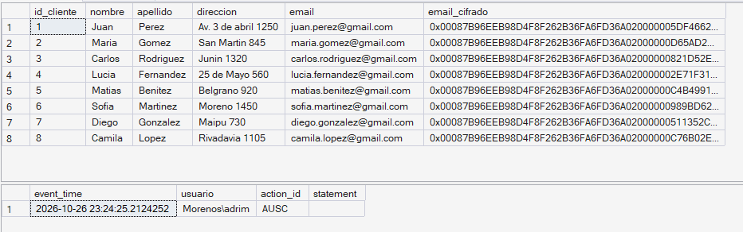

# Seguridad en Bases de Datos — Aplicación práctica sobre SQL Server 2025

> **Trabajo práctico — [Materia]**
> **Alumno/a:** [Tu nombre]
> **Profesor/a:** [Nombre del profesor]
> **Fecha:** [Fecha de entrega]
> **Motor:** Microsoft SQL Server 2025 (versión 17.0.1000), instancia local

---

> **Nota de uso:** los scripts se ejecutan sobre la base `base_distribuidora`. Los bloques marcados con *[CAPTURA]* indican dónde conviene insertar una imagen del resultado para el informe.

---

## 1. Introducción

La seguridad en bases de datos es el conjunto de controles que protegen la **confidencialidad**, la **integridad** y la **disponibilidad** de los datos almacenados. No se trata de una única herramienta, sino de un conjunto de medidas que actúan en distintos niveles, bajo el principio de **defensa en capas** (*defense in depth*): la idea de que ninguna defensa aislada es suficiente y que deben combinarse varias, de modo que si una falla, otra siga protegiendo la información.

Este trabajo toma una base de datos de un sistema de ventas con entregas y aplica, de forma práctica, las principales medidas de seguridad que ofrece SQL Server, explicando en cada caso **qué es**, **por qué aplica a esta base en particular**, **cómo se implementa** y **qué protege**.

### 1.1. Objetivo

Aplicar y documentar medidas de seguridad sobre una base de datos real, demostrando el funcionamiento de cada una con evidencia (consultas de verificación y capturas de pantalla).

### 1.2. Alcance

Se cubren seis medidas que representan las capas fundamentales de la seguridad en bases de datos:

| # | Medida | Capa de seguridad |
|---|--------|-------------------|
| 1 | Control de acceso y mínimo privilegio | Autenticación y autorización |
| 2 | Enmascaramiento dinámico de datos (DDM) | Protección de datos sensibles |
| 3 | Seguridad a nivel de fila (RLS) | Control de acceso fino |
| 4 | Cifrado a nivel de columna | Cifrado |
| 5 | Auditoría (SQL Server Audit) | Monitoreo y trazabilidad |
| 6 | Copias de seguridad (backups) | Disponibilidad y recuperación |

---

## 2. Descripción de la base de datos

La base modela un sistema de ventas con gestión de entregas. Sus tablas principales son:

- **Cliente** (`id_cliente`, `nombre`, `apellido`, `direccion`, `email`)
- **Telefono_Cliente** (`telefono`, `id_cliente`)
- **Venta** (`id_venta`, `fecha_venta`, `id_cliente`, `id_metodo_pago`)
- **Detalle_Venta** (`nro_linea`, `cantidad`, `precio_historico`, `id_producto`, `id_venta`)
- **Producto** (`id_producto`, `nombre_producto`, `precio_actual`, `stock`, `id_categoria`)
- **Categoria** (`id_categoria`, `nombre_categoria`)
- **Metodo_Pago** (`id_metodo_pago`, `descripcion`)
- **Entrega** (`id_entrega`, `fecha_entrega`, `estado_entrega`, `direccion_entrega`, `id_repartidor`, `id_venta`)
- **Repartidor** (`id_repartidor`, `nombre`, `apellido`, `telefono`)

### 2.1. Justificación del tema

Esta base contiene **datos personales** que deben protegerse:

- Datos de contacto de clientes: `nombre`, `apellido`, `direccion`, `email` y `telefono`.
- Datos de repartidores: `nombre`, `apellido`, `telefono`.
- Direcciones de entrega: `direccion_entrega`.

Ante una filtración, esta información podría usarse para fraude, suplantación de identidad o contacto no autorizado. Por eso la base es un buen caso para aplicar medidas de seguridad: no todos los usuarios deberían ver todos los datos, la información sensible debe estar protegida tanto en uso como en disco, y todo acceso debería poder auditarse.

---

## 3. Preparación del entorno de pruebas

Para demostrar las medidas necesitamos un usuario con permisos limitados que contraste con el administrador. El siguiente script crea un login y un usuario de prueba.

```sql
USE [base_distribuidora];
GO

-- Login a nivel de servidor (autenticación SQL para la demo)
CREATE LOGIN usuario_limitado
    WITH PASSWORD = 'Demo#Segura2026';
GO

-- Usuario dentro de la base, asociado al login
CREATE USER usuario_limitado FOR LOGIN usuario_limitado;
GO
```

> Para abrir una sesión como este usuario y probar los efectos, en SSMS se puede abrir una **nueva conexión** autenticándose con `usuario_limitado`, o usar `EXECUTE AS` / `REVERT` dentro de la misma consulta como se muestra más adelante.

---

## 4. Medida 1 — Control de acceso y principio de mínimo privilegio

### 4.1. Concepto

El **principio de mínimo privilegio** establece que cada usuario debe tener únicamente los permisos estrictamente necesarios para su tarea, y ninguno más. En SQL Server esto se implementa mediante **roles**: en lugar de asignar permisos sueltos a cada usuario, se crea un rol con un conjunto de permisos y se agregan usuarios a ese rol.

### 4.2. Por qué aplica a esta base

Un empleado que solo registra ventas no necesita poder **borrar clientes** ni **modificar precios de productos**. Darle más permisos de los necesarios aumenta el daño posible ante un error o un robo de credenciales.

### 4.3. Implementación

Creamos un rol para un perfil de "vendedor" que puede consultar y registrar ventas, pero no borrar clientes ni alterar la estructura.

```sql
USE [base_distribuidora];
GO

-- 1. Crear el rol
CREATE ROLE rol_vendedor;
GO

-- 2. Otorgar solo los permisos necesarios (mínimo privilegio)
GRANT SELECT ON dbo.Cliente       TO rol_vendedor;
GRANT SELECT ON dbo.Producto      TO rol_vendedor;
GRANT SELECT, INSERT ON dbo.Venta         TO rol_vendedor;
GRANT SELECT, INSERT ON dbo.Detalle_Venta TO rol_vendedor;

-- 3. Denegar explícitamente lo peligroso
DENY DELETE ON dbo.Cliente  TO rol_vendedor;
DENY UPDATE ON dbo.Producto TO rol_vendedor;
GO

-- 4. Agregar el usuario de prueba al rol
ALTER ROLE rol_vendedor ADD MEMBER usuario_limitado;
GO
```

### 4.4. Verificación

```sql
-- Ejecutamos una acción prohibida haciéndonos pasar por el usuario limitado
EXECUTE AS USER = 'usuario_limitado';

    -- Esto debe FALLAR por falta de permiso:
    DELETE FROM dbo.Cliente WHERE id_cliente = 1;

REVERT;
```

Resultado esperado: el motor rechaza la operación con un error de permiso denegado (`The DELETE permission was denied...`).


### 4.5. Qué demuestra

Que el acceso está segmentado por responsabilidad: el usuario puede hacer su trabajo (consultar y registrar ventas) pero no puede causar daño fuera de su ámbito. Es la primera y más importante capa de defensa.

---

## 5. Medida 2 — Enmascaramiento dinámico de datos (Dynamic Data Masking)

### 5.1. Concepto

El **Dynamic Data Masking (DDM)** oculta datos sensibles en los resultados de las consultas, mostrando una versión enmascarada (por ejemplo `aXXX@XXXX.com`) a los usuarios sin privilegio para verlos. El dato real **no se modifica** en la tabla: el enmascaramiento ocurre al momento de leer.

### 5.2. Por qué aplica a esta base

El `email`, la `direccion` y el `telefono` de los clientes son datos de contacto personales. Un operador que solo necesita identificar al cliente no tiene por qué ver el correo o la dirección completos.

### 5.3. Implementación

```sql
USE [base_distribuidora];
GO

-- Enmascarar el email del cliente (deja ver inicio y dominio parcial)
ALTER TABLE dbo.Cliente
    ALTER COLUMN email ADD MASKED WITH (FUNCTION = 'email()');

-- Enmascarar la dirección por completo
ALTER TABLE dbo.Cliente
    ALTER COLUMN direccion ADD MASKED WITH (FUNCTION = 'default()');

-- Enmascarar el teléfono dejando visibles los últimos 2 dígitos
ALTER TABLE dbo.Telefono_Cliente
    ALTER COLUMN telefono ADD MASKED WITH (FUNCTION = 'partial(0,"XXXX",2)');
GO

-- Asegurar que el usuario limitado NO puede desenmascarar
DENY UNMASK TO usuario_limitado;
GO
```

### 5.4. Verificación

```sql
-- Como administrador: se ven los datos reales
SELECT id_cliente, nombre, email, direccion FROM dbo.Cliente;

-- Como usuario limitado: se ven enmascarados
EXECUTE AS USER = 'usuario_limitado';
    SELECT id_cliente, nombre, email, direccion FROM dbo.Cliente;
REVERT;
```



### 5.5. Qué demuestra

Que es posible proteger datos sensibles **sin cifrarlos ni duplicarlos**, controlando quién los ve en claro según su permiso. Es útil para entornos de soporte o consulta donde se necesita identificar registros sin exponer la información completa.

> **Aclaración honesta:** el DDM es una protección a nivel de visualización, no un control criptográfico fuerte. Un usuario con permiso de consulta y creatividad podría inferir datos (p. ej. filtrando por valores). Por eso se combina con las demás capas, no se usa como única defensa.

---

## 6. Medida 3 — Seguridad a nivel de fila (Row-Level Security)

### 6.1. Concepto

La **Row-Level Security (RLS)** controla **qué filas** puede ver cada usuario dentro de una misma tabla, aplicando un filtro automático y transparente a todas las consultas. El filtro lo define una función de predicado asociada a la tabla mediante una *política de seguridad*.

### 6.2. Por qué aplica a esta base

Un **repartidor** solo debería ver las **entregas asignadas a él**, no las de todos los demás. La tabla `Entrega` tiene la columna `id_repartidor`, que es exactamente el criterio para filtrar.

### 6.3. Implementación

Usamos `SESSION_CONTEXT` para indicar qué repartidor está "conectado" y filtramos la tabla `Entrega` en función de eso.

```sql
USE [base_distribuidora];
GO

-- 1. Esquema separado para los objetos de seguridad (buena práctica)
CREATE SCHEMA Seguridad;
GO

-- 2. Función de predicado: devuelve fila "permitida" solo si el
--    id_repartidor coincide con el del contexto de sesión
CREATE FUNCTION Seguridad.fn_filtro_repartidor(@id_repartidor INT)
    RETURNS TABLE
    WITH SCHEMABINDING
AS
    RETURN
        SELECT 1 AS acceso_permitido
        WHERE @id_repartidor = CAST(SESSION_CONTEXT(N'id_repartidor') AS INT);
GO

-- 3. Política de seguridad que aplica el filtro a la tabla Entrega
CREATE SECURITY POLICY Seguridad.politica_entregas
    ADD FILTER PREDICATE Seguridad.fn_filtro_repartidor(id_repartidor)
    ON dbo.Entrega
    WITH (STATE = ON);
GO
```

### 6.4. Verificación

```sql
-- Simulamos la sesión del repartidor 1
EXEC sp_set_session_context 'id_repartidor', 1;
SELECT * FROM dbo.Entrega;   -- Solo entregas del repartidor 1

-- Simulamos la sesión del repartidor 2
EXEC sp_set_session_context 'id_repartidor', 2;
SELECT * FROM dbo.Entrega;   -- Solo entregas del repartidor 2
```



### 6.5. Qué demuestra

Que una misma tabla y una misma consulta (`SELECT * FROM Entrega`) devuelven resultados distintos según el usuario, sin que la aplicación tenga que agregar filtros manualmente. El control de acceso queda **en la base**, no en el código de la aplicación.

> Para desactivar la política durante las pruebas:
> ```sql
> ALTER SECURITY POLICY Seguridad.politica_entregas WITH (STATE = OFF);
> ```

---

## 7. Medida 4 — Cifrado a nivel de columna

### 7.1. Concepto

El **cifrado a nivel de columna** (*cell-level encryption*) cifra el contenido de una columna puntual usando una **clave simétrica**, que a su vez queda protegida por un **certificado**. A diferencia de TDE, que cifra toda la base a nivel de archivo, aquí se cifra solo el dato sensible elegido: queda almacenado como binario ilegible y únicamente puede leerse abriendo la clave con la autorización correspondiente. Es un cifrado **en reposo** disponible en todas las ediciones de SQL Server, incluida Express.

> **Nota sobre TDE:** la técnica estándar para cifrado en reposo es *Transparent Data Encryption* (TDE), que cifra los archivos completos de la base. Sin embargo, TDE **no está disponible en la edición Express** de SQL Server (solo Standard y Enterprise). Por eso este trabajo aplica cifrado a nivel de columna, que logra el mismo objetivo —datos ilegibles sin la clave— y es compatible con la edición utilizada.

### 7.2. Por qué aplica a esta base

El `email` del cliente es un dato personal que conviene almacenar cifrado. Así, aunque alguien acceda a la tabla o a los archivos de la base, ese dato aparece como una cadena binaria sin sentido y no puede leerse sin la clave.

### 7.3. Implementación

```sql
USE [base_distribuidora];
GO

-- 1. Clave maestra de la base (si todavia no existe)
IF NOT EXISTS (SELECT 1 FROM sys.symmetric_keys WHERE name = '##MS_DatabaseMasterKey##')
    CREATE MASTER KEY ENCRYPTION BY PASSWORD = 'Clave#Maestra#Fuerte2026';
GO

-- 2. Certificado que protege la clave simetrica
CREATE CERTIFICATE CertCifradoColumna
    WITH SUBJECT = 'Certificado para cifrado de columnas';
GO

-- 3. Clave simetrica con la que se cifran los datos
CREATE SYMMETRIC KEY ClaveEmail
    WITH ALGORITHM = AES_256
    ENCRYPTION BY CERTIFICATE CertCifradoColumna;
GO

-- 4. Columna nueva para guardar el email cifrado (binario)
ALTER TABLE dbo.Cliente ADD email_cifrado VARBINARY(256);
GO

-- 5. Cifrar los emails existentes
OPEN SYMMETRIC KEY ClaveEmail DECRYPTION BY CERTIFICATE CertCifradoColumna;

UPDATE dbo.Cliente
SET email_cifrado = ENCRYPTBYKEY(KEY_GUID('ClaveEmail'), email);

CLOSE SYMMETRIC KEY ClaveEmail;
GO
```

### 7.4. Verificación

```sql
-- SIN abrir la clave: la columna se ve como binario ilegible
SELECT id_cliente, email, email_cifrado FROM dbo.Cliente;

-- ABRIENDO la clave: se puede descifrar y leer el valor original
OPEN SYMMETRIC KEY ClaveEmail DECRYPTION BY CERTIFICATE CertCifradoColumna;

SELECT id_cliente,
       email_cifrado AS valor_almacenado,
       CONVERT(VARCHAR(100), DECRYPTBYKEY(email_cifrado)) AS email_descifrado
FROM dbo.Cliente;

CLOSE SYMMETRIC KEY ClaveEmail;
GO
```



### 7.5. Qué demuestra

Que el dato sensible queda almacenado **cifrado en reposo**: sin abrir la clave simétrica (protegida por el certificado) el contenido es ilegible, incluso para quien tenga acceso de lectura a la tabla. Complementa a las medidas anteriores, que protegen el acceso en uso.

---

## 8. Medida 5 — Auditoría (SQL Server Audit)

### 8.1. Concepto

La **auditoría** registra qué usuarios acceden a qué datos y qué operaciones realizan. Permite detectar accesos indebidos, investigar incidentes y cumplir requisitos de trazabilidad. SQL Server lo implementa con **SQL Server Audit**, que escribe los eventos en un archivo o en el registro de eventos de Windows.

### 8.2. Por qué aplica a esta base

La tabla `Cliente` contiene los datos más sensibles. Conviene dejar registro de **quién consulta o modifica** esos datos, para poder rendir cuentas ante un acceso no autorizado.

### 8.3. Implementación

```sql
-- 1. A nivel de servidor: destino de la auditoría (requiere que exista la carpeta)
USE master;
GO

CREATE SERVER AUDIT AuditoriaVentas
    TO FILE (FILEPATH = 'C:\SQLAudit\');
GO

ALTER SERVER AUDIT AuditoriaVentas WITH (STATE = ON);
GO

-- 2. A nivel de base: qué acciones auditar
USE [base_distribuidora];
GO

CREATE DATABASE AUDIT SPECIFICATION AuditoriaCliente
    FOR SERVER AUDIT AuditoriaVentas
    ADD (SELECT, INSERT, UPDATE, DELETE
         ON dbo.Cliente BY public)
    WITH (STATE = ON);
GO
```

### 8.4. Verificación

```sql
-- Generamos actividad
SELECT * FROM dbo.Cliente;

-- Leemos el registro de auditoría
SELECT event_time,
       server_principal_name AS usuario,
       action_id,
       statement
FROM sys.fn_get_audit_file('C:\SQLAudit\*.sqlaudit', DEFAULT, DEFAULT);
```



### 8.5. Qué demuestra

Que toda acción sobre los datos sensibles queda registrada de forma independiente del usuario, lo que permite reconstruir qué pasó ante un incidente. Es la capa de **trazabilidad**: no previene el acceso, pero lo hace visible y rastreable.

---

## 9. Medida 6 — Copias de seguridad (Backups)

### 9.1. Concepto

Una **copia de seguridad** (*backup*) es un respaldo del contenido de la base de datos que permite restaurarla ante una pérdida: borrado accidental, corrupción de archivos, falla del disco o un ataque de *ransomware*. Mientras las medidas anteriores protegen la **confidencialidad** y la **integridad**, los backups protegen la **disponibilidad**: la garantía de que los datos van a seguir estando ahí y se pueden recuperar. Sin un backup probado, cualquier incidente grave significa perder la información de forma definitiva.

### 9.2. Por qué aplica a esta base

La base `base_distribuidora` guarda toda la operación del negocio: clientes, ventas, detalles, entregas y repartidores. Si el archivo de la base se corrompe o se borra, sin un respaldo se pierden todas las ventas registradas. Por eso una política de backups es una medida de seguridad imprescindible.

### 9.3. Implementación

```sql
-- 1. Copia de seguridad COMPLETA de la base
BACKUP DATABASE [base_distribuidora]
    TO DISK = 'C:\Backups\base_distribuidora_FULL.bak'
    WITH FORMAT,
         NAME = 'Backup completo - base_distribuidora',
         STATS = 10;
GO
```

> La carpeta `C:\Backups\` debe existir antes de ejecutar el backup. Buenas prácticas:
> - Guardar una **copia en otra ubicación** (disco externo o nube), para que un problema en el disco principal no se lleve también el respaldo.
> - Hacer backups **periódicos**, no una sola vez.
> - Como defensa ante *ransomware*, mantener al menos una copia **offline o inmutable**.

### 9.4. Verificación

La parte más importante de un backup es comprobar que **se puede restaurar**: un respaldo que nunca se probó no sirve como garantía. Se verifica restaurándolo con otro nombre, sin tocar la base original.

```sql
-- Verificar que el archivo de backup es valido
RESTORE VERIFYONLY
    FROM DISK = 'C:\Backups\base_distribuidora_FULL.bak';
GO

-- Restaurar como una base nueva de prueba (no pisa la original)
RESTORE DATABASE [base_distribuidora_PRUEBA]
    FROM DISK = 'C:\Backups\base_distribuidora_FULL.bak'
    WITH MOVE 'base_distribuidora'     TO 'C:\Backups\prueba.mdf',
         MOVE 'base_distribuidora_log' TO 'C:\Backups\prueba_log.ldf',
         RECOVERY;
GO
```

> Los nombres lógicos (`base_distribuidora` y `base_distribuidora_log`) pueden consultarse con `RESTORE FILELISTONLY FROM DISK = '...'` si difieren de los del ejemplo.


### 9.5. Qué demuestra

Que la información está protegida ante su pérdida: aunque la base original se dañe o se borre, existe un respaldo a partir del cual recuperarla. Es la capa de **disponibilidad y recuperación**, que cierra la tríada de seguridad junto con la confidencialidad y la integridad cubiertas por las medidas anteriores.

---

## 10. Conclusión

A lo largo del trabajo se aplicaron seis medidas de seguridad sobre la base de datos de ventas, cada una cubriendo una capa distinta:

- **Control de acceso y mínimo privilegio** limitan *qué puede hacer* cada usuario.
- **Dynamic Data Masking** y **Row-Level Security** controlan *qué datos y qué filas ve* cada usuario.
- **El cifrado a nivel de columna** protege los datos sensibles *en reposo*, guardandolos ilegibles sin la clave.
- **SQL Server Audit** aporta *trazabilidad* de los accesos.
- **Las copias de seguridad** garantizan la *disponibilidad* y la recuperación de los datos ante pérdidas o fallas.

La conclusión principal es que la seguridad en bases de datos no depende de una sola herramienta, sino de la **combinación de controles complementarios** (defensa en capas). Cada medida cubre una debilidad que las otras no atienden, y es su aplicación conjunta la que brinda una protección real de la confidencialidad, integridad y disponibilidad de los datos.

---

## 11. Referencias

- Microsoft. *SQL Server security documentation* — Microsoft Learn (learn.microsoft.com).
- Microsoft. *Dynamic Data Masking*, *Row-Level Security*, *Transparent Data Encryption*, *SQL Server Audit*, *SQL Vulnerability Assessment* — Microsoft Learn.
